# 🍰 Cinthiê Confeitaria

Projeto da disciplina **Desenvolvimento Frontend para Web (A2 · 2026.2)** — Prof. Cid Andrade.
Entrega 1 (HTML) e Entrega 2 (CSS e JavaScript).

🔗 **Site hospedado:** [yasminalba.github.io/cinthie_confeitaria](https://yasminalba.github.io/cinthie_confeitaria/)

**Slides da apresentação:** [apresentacao/nome-do-arquivo.pptx](apresentacao/slides cinthie.pptx)

## 1. Nomes dos alunos

- Ryan Everton Andrade Simões — RGM: 47647663 - GitHub: 8enn7
- Vinicius Ferreira da Silva — RA: 47432691 - GitHub: viniferreiradevtech
- Yasmin America Mollinedo Alba — RA: 47071303 - GitHub: yasminalba
- Nicolas Miguel Tavares — RA: 47658037 - GitHub: nicolasmigueltavares2007-maker
- João Paulo de Lima Rodrigues — RA: 47850876 - GitHub: jotinzl

## 2. Introdução

A Cinthiê Confeitaria é uma confeitaria de bairro localizada no Tatuapé, em São Paulo, que produz e vende bolos caseiros, bolos de festa, doces finos, tortas, bolos de pote, brigadeiros e brownies, sempre feitos no dia.

O objetivo do site é apresentar a confeitaria, o cardápio e os serviços de encomenda e delivery, facilitar o contato dos clientes (WhatsApp, formulário e orçamento) e reunir as avaliações do Google. O site foi pensado para ser simples de navegar, com um visual que reflete a identidade da confeitaria: preto, dourado e creme.

## 3. Desenvolvimento

### Entrevista e visita à organização

Para conhecer a Cinthiê Confeitaria e entender suas necessidades, o grupo realizou uma **visita presencial** à organização.

Durante a visita, conhecemos o espaço, observamos como o estabelecimento funciona e conversamos com os responsáveis. Também levantamos informações sobre os produtos, os serviços, os horários e a forma de atendimento aos clientes. Essas informações definiram quais conteúdos entrariam no site e como seriam organizados.

### Registro do contato

A foto abaixo registra o contato do grupo com a organização durante a visita presencial:

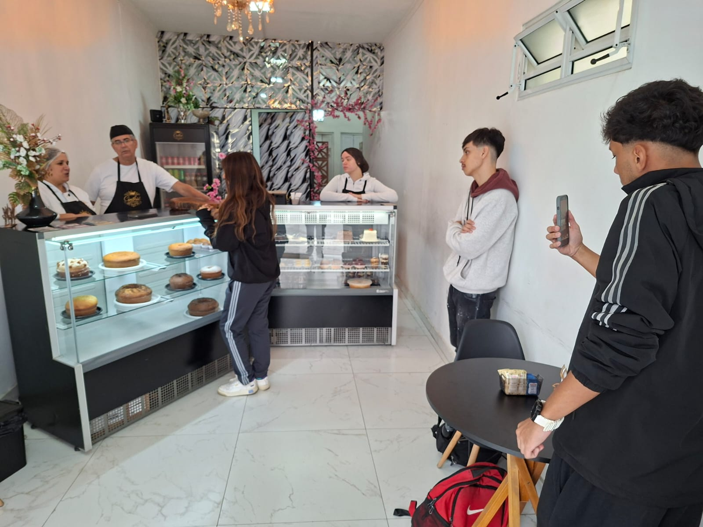

Forma de contato utilizada: visita presencial.

### Formas de contato da confeitaria

- WhatsApp: (11) 93935-9449
- Instagram: confeitaria_cinthie
- Endereço: R. Cesário Galero, 262 - Tatuapé, São Paulo - SP, 03071-000
- Horário: segunda a sábado, das 09:00 às 19:00

### Estrutura do site

O site tem **12 páginas HTML** interligadas por um menu de navegação consistente:

| Página | Arquivo | Conteúdo |
|---|---|---|
| Início | `index.html` | Apresentação, categorias, novidades, avaliações e chamada para encomenda |
| Quem somos | `pages/quem-somos.html` | História, números da confeitaria e entrevista em áudio |
| Cardápio | `pages/cardapio.html` | Produtos e preços, com busca |
| Delivery | `pages/delivery.html` | Como funciona, áreas e valores de entrega |
| Feedbacks | `pages/feedbacks.html` | Avaliações do Google |
| Selo de fidelidade | `pages/fidelidade.html` | Cartão de fidelidade interativo |
| Galeria | `pages/galeria.html` | Fotos dos produtos, com ampliação |
| Orçamento | `pages/orcamento.html` | Formulário de solicitação de orçamento |
| Contato | `pages/contato.html` | Formulário de contato com validação nativa |
| Endereço | `pages/endereco.html` | Mapa e informações de localização |
| Política e Termos | `pages/politica.html`, `pages/termos.html` | Privacidade e condições de uso |

Organização das pastas:

```
cinthie_confeitaria/
├── index.html
├── pages/          (demais páginas HTML)
├── css/style.css   (CSS único, organizado em seções numeradas)
├── js/script.js    (JavaScript do site)
├── assets/
│   ├── imagens/
│   ├── audio/
│   └── video/
└── README.md
```

### Requisitos técnicos atendidos

- **HTML5 semântico:** `header`, `nav`, `main`, `section`, `article` e `footer` em todas as páginas.
- **Formulário de contato** com validação nativa do HTML5 (`required`, `type="email"`, `type="tel"`, `pattern`), sem depender de JavaScript para a validação básica.
- **Áudio e vídeo:** entrevista em áudio na página "Quem somos" e vídeo do "Morango cravejado" na página inicial.
- **SVG:** ícones em SVG embutidos no HTML (localização, relógio, telefone, coração, categorias do cardápio), estilizados com `currentColor` para seguir as cores do site.
- **CSS:** arquivo único com variáveis de cor e tipografia (`:root`), componentes padronizados (cards, botões, tabelas, formulários), **Grid Layout** e **Flexbox** para a organização dos elementos e layout responsivo com `@media`.
- **JavaScript com resposta a eventos:** ver a seção abaixo.

### JavaScript

O `js/script.js` responde a eventos do usuário (clique, rolagem, digitação, teclado). Os principais componentes são:

- **Status da loja:** mostra "Aberto agora" ou "Fechado" de acordo com o horário de funcionamento, no fuso de São Paulo.
- **Menu mobile:** botão que abre e fecha o menu em telas pequenas.
- **Barra flutuante, barra de progresso e botão "voltar ao topo"**, ligados à rolagem da página.
- **Busca no cardápio:** filtra os produtos enquanto a pessoa digita.
- **Cartão de fidelidade:** os selos podem ser marcados com clique ou teclado.
- **Galeria com lightbox:** ao clicar numa foto, ela abre ampliada.
- **Formulários:** máscara de telefone e contador de caracteres no orçamento. Os formulários de contato e de orçamento enviam as mensagens pelo [FormSubmit](https://formsubmit.co/) para o Gmail da confeitaria (`confeitariacinthie@gmail.com`), sem recarregar a página, e mostram uma mensagem de confirmação na própria tela.
- **Efeitos visuais:** elementos que aparecem ao rolar a página e transição suave entre páginas (respeitando a preferência de movimento reduzido do usuário).

### Pesquisa de leiaute e testes de identidade visual

#### Sites de referência

Antes de montar o layout, o grupo analisou sites de confeitarias e brigaderias conhecidas, buscando o que funciona para quem quer **ver o cardápio, conhecer o lugar e pedir rápido**.

| Referência | O que observamos | O que levamos para o nosso site |
|---|---|---|
| [Confeitaria Colombo](https://confeitariacolombo.com.br) (Rio de Janeiro) | Marca tradicional que passa **história e sofisticação**. Tem várias unidades, cada uma com endereço, telefone e horário próprios, e cardápio extenso. | Tom elegante e tradicional (preto, dourado e fonte serifada nos títulos) e uma página de **endereço** com mapa, horário e telefone da loja. |
| [Confeitaria Dama](https://confeitariadama.com.br/) (São Paulo) | Confeitaria de bairro que cresceu para várias unidades, com produtos inspirados na pâtisserie francesa. Cada unidade tem endereço, horário e telefone ou WhatsApp próprios, e há **delivery próprio e encomendas por WhatsApp**. | Cardápio em **cards por categoria** com preço visível, página de **delivery e encomendas** e rodapé com todas as formas de contato. |
| [Brigaderia](https://www.brigaderia.com.br) (São Paulo) | Doceria de bairro que trabalha com sabores variados e encomendas. | Foco nos produtos, nas **encomendas e no orçamento**, com chamada para o WhatsApp em destaque. |

**Conclusões da pesquisa:** os sites mais eficientes têm (1) botão de pedido sempre à vista, (2) cardápio com preço visível, (3) fotos grandes dos produtos, (4) endereço, horário e contato fáceis de achar e (5) visual coerente com o tipo de loja. Como a Cinthiê é uma confeitaria de bairro com acabamento fino, escolhemos um visual **sofisticado, mas aconchegante**, com o botão do WhatsApp no topo de todas as páginas, cardápio em cards e rodapé completo.

#### Paletas testadas

Para escolher as cores, o grupo testou **três paletas** aplicadas ao próprio site (variando apenas as variáveis de cor em `:root`) e comparou aparência, identidade com a marca e legibilidade. A taxa de contraste foi calculada pela fórmula do WCAG, em que 4,5 ou mais é o mínimo recomendado para texto normal.

| | **A. Preto, dourado e creme (escolhida)** | B. Rosa e branco | C. Marrom chocolate e caramelo |
|---|---|---|---|
| Cabeçalho e rodapé | `#000000` | `#5A2A3C` | `#2B1A12` |
| Destaque (botões, links) | `#C9A227` | `#D86F94` | `#B5651D` |
| Cards | `#F5EFE0` | `#FFF7F9` | `#FFF8EE` |
| Fundo | `#EBE6C0` | `#FCE4EC` | `#EFE0CC` |
| Texto marrom sobre o card | 11,7 | 12,7 | 15,8 |
| Texto do botão sobre o destaque | **8,0** | 4,2 | 4,1 |
| Destaque sobre o cabeçalho | **8,7** | 3,6 | 3,8 |

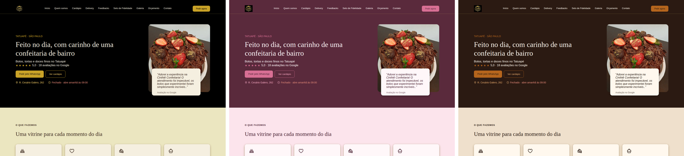

**Por que a A venceu:**

- Foi a única em que os botões e os links dourados têm **contraste confortável** tanto com o texto escuro do botão (8,0) quanto sobre o cabeçalho preto (8,7). Nas outras duas, esses valores ficaram abaixo de 4,5.
- Combina com a **logo da confeitaria**, que já é uma coroa dourada sobre fundo preto.
- Passa a sensação de **sofisticação e aconchego** que queremos, e o creme e o dourado fazem as fotos de bolos e doces se destacarem.
- A paleta B ficou mais infantil e com pouco contraste nos botões. A C ficou próxima da A, mas o caramelo perdeu o brilho do dourado e parecia menos premium.

#### Tipografia

- **Títulos:** Georgia, uma fonte serifada que transmite tradição e elegância, em linha com a logo e com a referência da Confeitaria Colombo.
- **Textos, menus e formulários:** Arial, sem serifa, para leitura limpa em qualquer tela.
- Usamos só **fontes do sistema**, o que deixa as páginas rápidas e evita depender de bibliotecas externas.

#### Componentes padronizados

Para manter a identidade unificada, todas as páginas usam os mesmos componentes definidos uma única vez no `css/style.css`: **cards** (cardápio, avaliações, delivery), **botões** (principal, secundário e do WhatsApp), **tabelas** de valores, **formulários** com o mesmo estilo de campos e **cabeçalho e rodapé** idênticos. As cores e as fontes ficam em variáveis no `:root`, o que permitiu testar as paletas acima trocando só esses valores.

### Desafios encontrados

- **Escolher a paleta certa.** Foi o maior desafio do grupo: não bastava combinar cores bonitas, era preciso que elas se identificassem com a marca e com a logo da confeitaria, sem prejudicar a leitura.
- Manter um CSS único e organizado para 11 páginas, evitando regras duplicadas. Houve um conflito entre as páginas de avaliações (início e feedbacks), resolvido separando o grid de cada página e deixando compartilhado só o visual básico do card.
- Deixar o layout responsivo (desktop, tablet e celular) com Grid e Flexbox.
- Integrar o JavaScript sem prejudicar a acessibilidade (foco por teclado, `aria-label`, movimento reduzido).
- Trabalhar em grupo com Git e GitHub, o que exigiu comunicação constante entre os integrantes.

## 4. Como seria o processo com IA

Se o site fosse desenvolvido por uma IA do início ao fim, o processo equivalente seria:

1. **Levantamento:** as informações reais (produtos, preços, horários, fotos, tom de voz) ainda precisariam ser coletadas por pessoas, porque a IA não conhece a confeitaria. Elas seriam passadas à IA em um briefing.
2. **Prompt de estrutura:** pedir à IA a lista de páginas, o menu e o HTML semântico de cada uma, informando os requisitos da atividade.
3. **Prompt de identidade visual:** informar a paleta, as fontes e referências, e pedir um CSS com variáveis, componentes reutilizáveis, Grid e Flexbox.
4. **Prompt de interatividade:** descrever os comportamentos desejados (menu, busca, lightbox, formulário) e pedir o JavaScript.
5. **Revisão humana:** testar em vários tamanhos de tela, validar no W3C, corrigir erros e conferir se o conteúdo é verdadeiro.

O resultado sai mais rápido, mas fica genérico e pode conter erros de layout, regras de CSS duplicadas ou conteúdo inventado. Por isso a coleta de dados e a revisão continuam sendo trabalho humano.

## 5. Uso de IA

- **Modelo utilizado:** Claude (Anthropic).
- **Motivação:** a IA foi usada como apoio, principalmente para **ideias e sugestões de JavaScript** (os componentes interativos listados acima), para **corrigir e organizar o CSS** (por exemplo, o conflito de grids nas páginas de avaliações e a remoção de regras duplicadas) e para **testar as três paletas de cores** e calcular o contraste de cada uma.
- **Verificação das respostas:** todo código sugerido foi lido e testado no navegador antes de entrar no projeto, em diferentes larguras de tela. O HTML e o CSS finais foram validados no W3C Validator e no CSS Validation Service, e o resultado foi comparado com o que a atividade pede.
- **Limites:** o conteúdo do site (textos, produtos, preços, fotos e avaliações) vem da visita à confeitaria, e não da IA.

## 6. Validação W3C

Todas as 12 páginas do site foram validadas no [W3C Markup Validator](https://validator.w3.org/), e o CSS foi validado no [CSS Validation Service](https://jigsaw.w3.org/css-validator/). O resultado foi **nenhum erro e nenhum aviso** em todas as páginas.

**HTML (página inicial):**

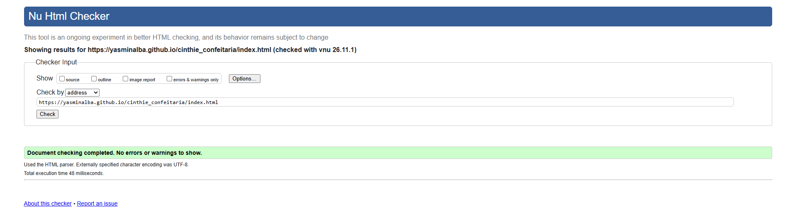

<details>
<summary>Ver a validação das outras 11 páginas</summary>

**Quem somos**

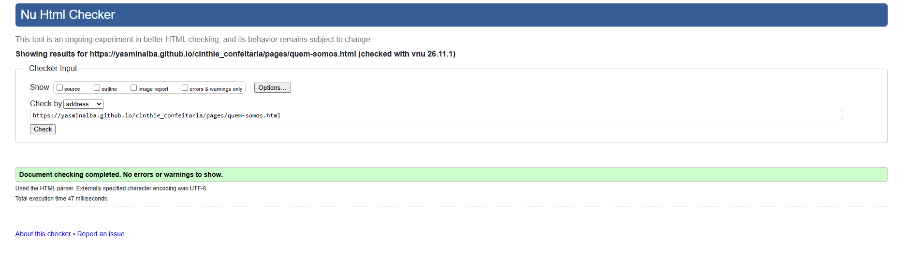

**Cardápio**

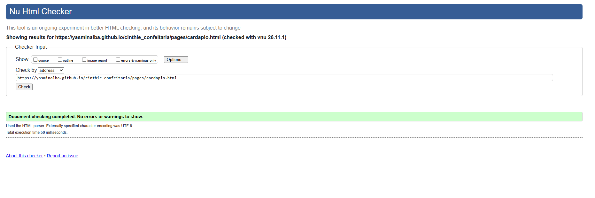

**Delivery**

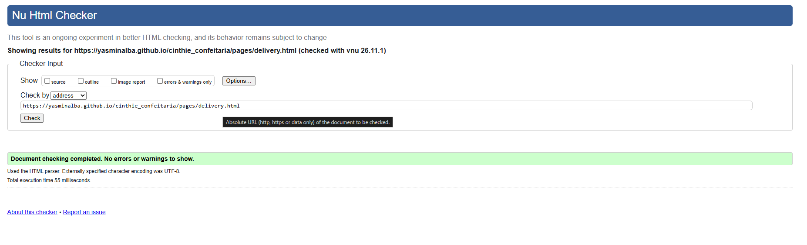

**Endereço**

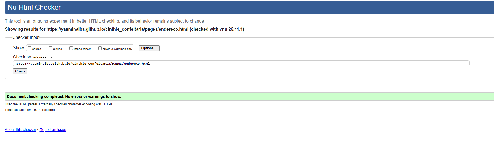

**Galeria**

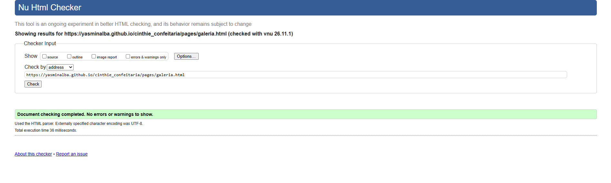

**Feedbacks**

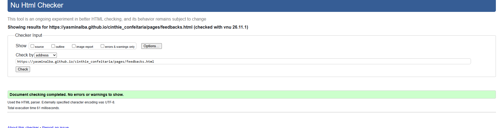

**Selo de fidelidade**

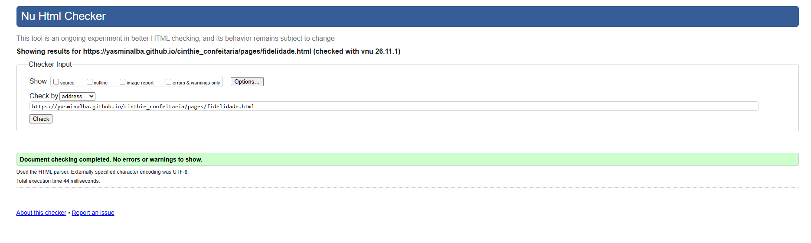

**Orçamento**

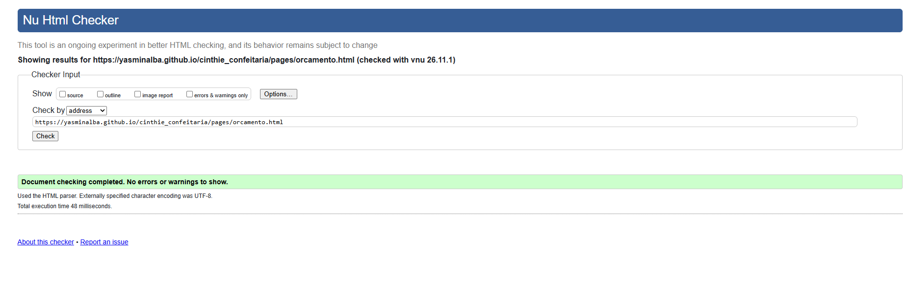

**Contato**

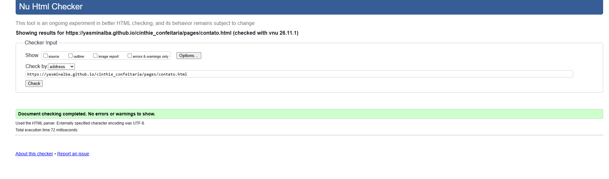

**Política de privacidade**

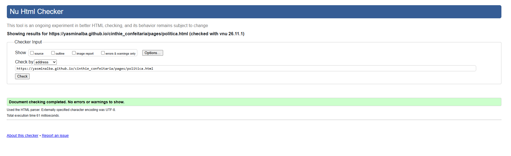

**Termos e condições**

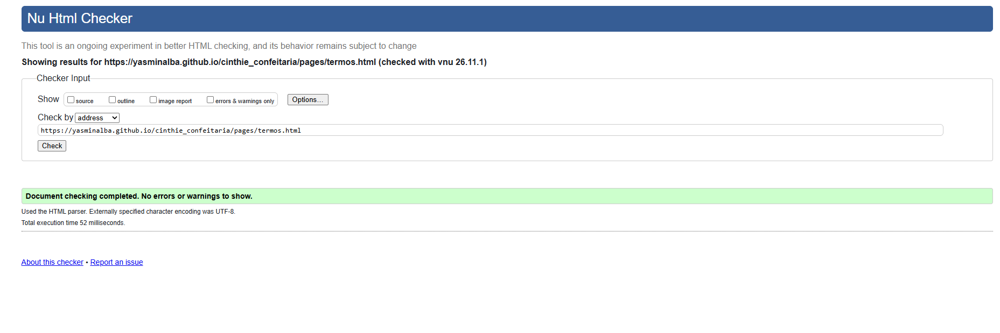

</details>

**CSS:**


## 7. Site hospedado

🔗 [Acesse o site da Cinthiê Confeitaria](https://yasminalba.github.io/cinthie_confeitaria/)

Hospedagem: GitHub Pages.

## 8. Domínio

- **Domínio escolhido:** `cinthiêconfeitaria.com.br`
- **Disponibilidade:** a pesquisa no [Registro.br](https://registro.br) mostrou que o domínio está **disponível para registro**, ao preço de R$ 40,00 por 1 ano, R$ 76,00 por 2 anos ou R$ 184,00 por 5 anos (valores no dia da pesquisa).

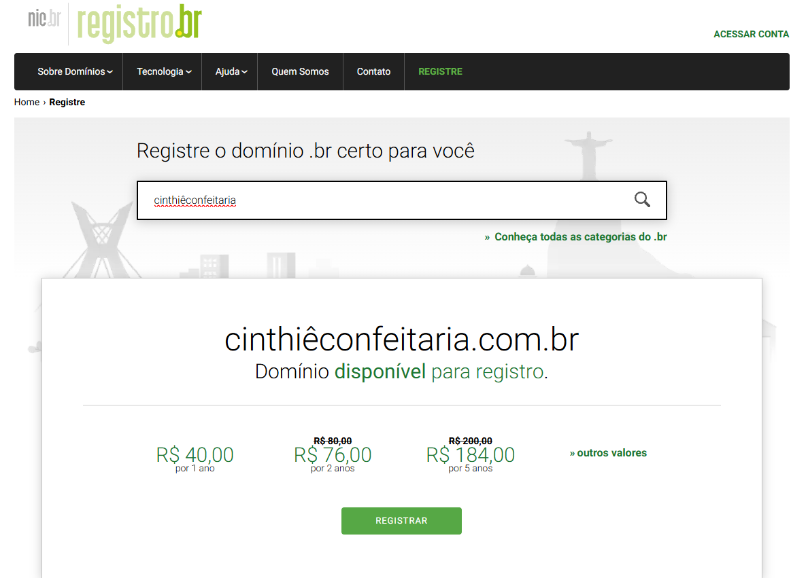

- **Por que esse:** tem o nome exato da marca, é fácil de lembrar e o `.com.br` passa confiança para o público brasileiro, com custo baixo. Como muita gente digita o endereço sem acento, o ideal seria também conferir a versão `cinthieconfeitaria.com.br` e, se estiver livre, registrar as duas e apontar uma para a outra.
- **Processo de aquisição:**
  1. Pesquisar a disponibilidade do nome no Registro.br (print acima).
  2. Criar o cadastro do titular no Registro.br, que será a própria Cinthie, com CPF ou CNPJ.
  3. Escolher o prazo (1, 2 ou 5 anos), clicar em "Registrar" e pagar a anuidade.
  4. Apontar o domínio para a hospedagem configurando o DNS. No GitHub Pages, isso é feito com um arquivo `CNAME` no repositório e os registros DNS indicados na documentação.
  5. Ativar o HTTPS e testar o acesso.

## 9. Conclusão

Desenvolver o site da Cinthiê Confeitaria nos permitiu aplicar na prática o que estudamos: HTML5 semântico, CSS organizado com Grid e Flexbox, JavaScript com eventos, validação, hospedagem e trabalho em grupo com Git e GitHub.

**O mais difícil foi escolher a paleta de cores.** Testamos combinações diferentes para descobrir qual se identificava mais com a marca e com a identidade visual da confeitaria. Percebemos que a cor não é só estética: ela precisa combinar com a logo, passar o clima da loja e garantir boa leitura. Chegamos ao preto, dourado e creme, que une sofisticação e aconchego.

**O que aprendemos:**

- Que a **visita à confeitaria** foi essencial para que o site refletisse a realidade do negócio, e não uma ideia genérica.
- Que um **CSS único e organizado**, com variáveis e componentes reutilizáveis, facilita manter a identidade e fazer mudanças, como trocar a paleta, sem mexer em cada página.
- Que **Grid e Flexbox** deixam o layout flexível e responsivo, mas um conflito entre regras pode quebrar uma página inteira, então vale testar sempre.
- Que o **JavaScript** deixa o site mais vivo e útil (busca, menu, status da loja), desde que continue acessível.
- Que a **IA ajuda como apoio**, mas é preciso testar e revisar tudo o que ela sugere.
- Que **trabalhar em grupo** com Git e GitHub exige comunicação e organização.
